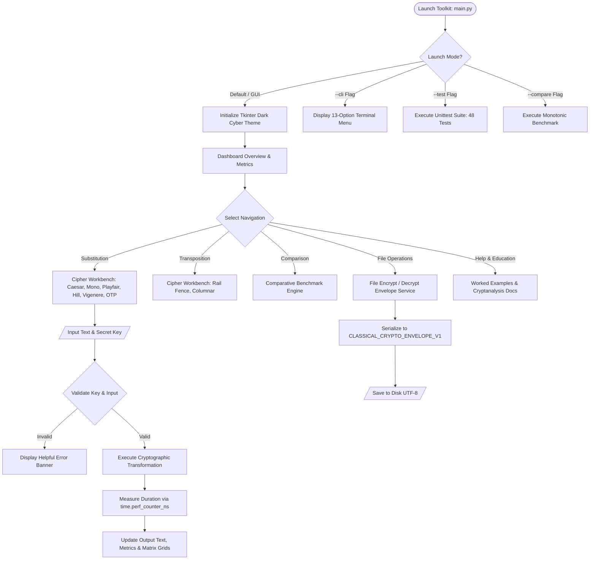

# DESIGN AND DEVELOPMENT OF A CLASSICAL CRYPTOGRAPHY TOOLKIT

---

## 1. Title Page

**Project Title:** Design and Development of a Classical Cryptography Toolkit  
**Course / Degree:** Bachelor of Technology / Bachelor of Engineering in Electronics & Computer Engineering (ECM)  
**Academic Year:** 2026–2027  
**Semester:** Final Year  
**Subject:** Network Security  

### Student Details:
* **Student Name:** `[ENTER_STUDENT_NAME]`
* **Roll Number:** `[ENTER_ROLL_NUMBER]`
* **Batch:** `[ENTER_BATCH_ID]`
* **Department:** Department of Electronics and Computer Engineering (ECM)
* **College / University:** `[ENTER_INSTITUTION_NAME]`

### Faculty Guide:
* **Faculty Guide Name:** `[ENTER_FACULTY_GUIDE_NAME]`
* **Designation:** `[ENTER_FACULTY_DESIGNATION]`
* **Department:** Department of Electronics and Computer Engineering

---

## 2. Objectives

The primary objectives of this mini-project are:

1. **Educational Foundation:** Implement eight foundational classical cryptographic algorithms from scratch using standard Python 3, demonstrating mathematical concepts without relying on third-party black-box libraries.
2. **Comprehensive Algorithm Coverage:** Cover both major branches of classical ciphers:
   * **Substitution Ciphers:** Caesar, Monoalphabetic, Playfair, Hill (2×2 modular matrix), Vigenère (polyalphabetic), and One-Time Pad (Vernam).
   * **Transposition Ciphers:** Rail Fence (zigzag) and Columnar Transposition (irregular grid).
3. **Professional Cybersecurity User Interface:** Design a responsive, cyber-themed desktop application using Python Tkinter/ttk with a dark navy background, neon cyan accents, real-time character counters, execution time metrics, and clipboard utilities.
4. **Interactive Command-Line Interface:** Provide a menu-driven CLI supporting all 13 required operations for terminal-based environments.
5. **High-Resolution Performance Benchmarking:** Measure precise execution time using `time.perf_counter_ns()` across all ciphers with side-by-side comparative analysis.
6. **Secure Text File Encryption/Decryption Workflow:** Formulate a versioned JSON envelope format (`CLASSICAL_CRYPTO_ENVELOPE_V1`) for file operations that preserves UTF-8 formatting while strictly preventing secret key leakage in metadata.
7. **Empirical Cryptanalysis Education:** Document the vulnerabilities, mathematical limitations, and historical attack vectors (frequency analysis, known plaintext, Kasiski examination) for each cipher, emphasizing why classical ciphers must not be used for modern communication security.

---

## 3. Problem Statement

Modern cybersecurity curricula heavily emphasize abstract modern cryptosystems (AES, RSA, ECC). However, understanding modern cryptography requires an intuitive grounding in the foundational principles of confusion and diffusion, modular arithmetic, matrix transformations, and letter frequency distributions.

Historically, students encounter classical cryptography through static textbook formulas or fragmented online scripts that:
* Lack proper error validation (e.g. failing on non-invertible Hill matrices or invalid substitution alphabets).
* Fail to preserve punctuation, spaces, and casing.
* Omit reverse-pattern transformations and boundary conditions.
* Provide no cohesive desktop interface or side-by-side comparative benchmarks.

To bridge this gap, this project develops a robust, unified **Classical Cryptography Toolkit** providing interactive encryption/decryption, visual matrix/grid representations, high-resolution execution timing, file-level envelope security, and comprehensive automated test suites.

---

## 4. Software Requirements

### Hardware Requirements:
* **Processor:** 64-bit Dual-Core Intel/AMD or Apple Silicon (M1/M2/M3/M4)
* **RAM:** 2 GB minimum (4 GB recommended)
* **Storage:** 50 MB of available disk space
* **Display:** 1280 × 800 minimum screen resolution

### Software Requirements:
* **Operating System:** Cross-platform (macOS 12+, Windows 10/11, Ubuntu 20.04+ LTS)
* **Runtime Environment:** Python 3.8 or higher (Tested and verified on Python 3.13.1)
* **GUI Framework:** Python standard library `tkinter` (Tk 8.6+)
* **Dependencies:** Python Standard Library (`secrets`, `math`, `time`, `json`, `pathlib`, `re`, `argparse`, `unittest`) — **Zero external dependencies required**.

---

## 5. System Design (Flowchart)

### 5.1 Architecture Workflow

---

## 6. Algorithms

### 6.1 Caesar Cipher (Shift Cipher)
* **Key:** Integer $k \in [0, 25]$. Shifts are normalized: $k \pmod{26}$.
* **Encryption:** For each alphabetic character $P_i$:
  $$C_i = (P_i + k) \pmod{26}$$
* **Decryption:**
  $$P_i = (C_i - k + 26) \pmod{26}$$
* **Characteristics:** Preserves case and non-alphabetic symbols. Keyspace size: 26 (25 non-trivial).

### 6.2 Monoalphabetic Substitution Cipher
* **Key:** Arbitrary 26-letter permutation $K = [k_0, k_1, \dots, k_{25}]$ where $\{k_i\} = \{A \dots Z\}$.
* **Key Generation:** Fisher-Yates shuffle utilizing `secrets.randbelow`.
* **Encryption:** Maps the $i$-th letter of the alphabet to $k_i$.
* **Decryption:** Uses the inverse lookup map $k_i \mapsto A_i$.
* **Keyspace:** $26! \approx 4.03 \times 10^{26}$. Vulnerable to unigram frequency analysis.

### 6.3 Playfair Cipher
* **Key:** Keyword condensed into a $5 \times 5$ matrix, combining `I` and `J`.
* **Preprocessing:**
  1. Filter letters, uppercase, map `J` $\to$ `I`.
  2. Form digraphs $(c_1, c_2)$. If $c_1 == c_2$, insert filler `'X'` (or `'Q'` if $c_1 == 'X'$).
  3. If text has odd length, append trailing `'X'`.
* **Transformation Rules:**
  * Same Row: Shift right (encrypt) / Shift left (decrypt) modulo 5.
  * Same Column: Shift down (encrypt) / Shift up (decrypt) modulo 5.
  * Rectangle: Swap columns: $(r_1, c_2)$ and $(r_2, c_1)$.

### 6.4 Hill Cipher (2×2 Matrix)
* **Key:** Matrix $K = \begin{pmatrix} a & b \\ c & d \end{pmatrix}$ over $\mathbb{Z}_{26}$.
* **Invertibility Condition:** $\gcd(\det(K), 26) = 1$, where $\det(K) = (ad - bc) \pmod{26}$.
* **Inverse Matrix:**
  $$K^{-1} = \det(K)^{-1} \cdot \begin{pmatrix} d & -b \\ -c & a \end{pmatrix} \pmod{26}$$
* **Transformation:** For vector $P = \begin{pmatrix} p_1 \\ p_2 \end{pmatrix}$:
  $$C = K \cdot P \pmod{26}, \quad P = K^{-1} \cdot C \pmod{26}$$

### 6.5 Vigenère Cipher (Polyalphabetic)
* **Key:** Alphabetic keyword $K = [k_0, k_1, \dots, k_{L-1}]$.
* **Transformation:**
  $$C_i = (P_i + K_{j \pmod L}) \pmod{26}$$
* Non-alphabetic characters do NOT advance the keyword counter $j$.

### 6.6 One-Time Pad (Vernam Cipher)
* **Key:** Cryptographically random sequence generated using Python `secrets` with length $L \ge \text{alphabetic characters in } P$.
* **Encryption:** $C_i = (P_i + K_i) \pmod{26}$.
* **Security:** Shannon's Perfect Secrecy theorem applies if key is truly random, never reused, kept confidential, and equals message length.

### 6.7 Rail Fence Cipher (Zigzag Transposition)
* **Key:** Integer rails count $r \ge 1$.
* **Transformation:** Characters oscillate diagonally across rows: $0, 1, \dots, r-1, r-2, \dots, 0$.
* Rows are extracted sequentially during encryption; pattern lengths determine slice partitions during decryption.

### 6.8 Columnar Transposition Cipher
* **Key:** Keyword or column permutation.
* **Ordering:** Stable alphabetical sort (resolving repeated character ties left-to-right).
* **Grid Handling:** Exact irregular columnar transposition. Columns are partitioned based on quotient and remainder $L \pmod W$, ensuring exact round-trip preservation.

---

## 7. Program Modules

The codebase is organized into a modular architecture:

| Module Path | Primary Responsibility |
|---|---|
| `main.py` | Application entry point; CLI argument parsing (`--cli`, `--test`, `--compare`). |
| `src/cryptotoolkit/cli.py` | Interactive terminal interface implementing the 13 required menu options. |
| `src/cryptotoolkit/ciphers/base.py` | Abstract `BaseCipher` class, high-resolution timer wrapper, and `CipherResult` dataclass. |
| `src/cryptotoolkit/ciphers/caesar.py` | Caesar shift cipher implementation. |
| `src/cryptotoolkit/ciphers/monoalphabetic.py` | Monoalphabetic substitution and random key generator. |
| `src/cryptotoolkit/ciphers/playfair.py` | Playfair $5 \times 5$ matrix generation, digraph padding, and transformation. |
| `src/cryptotoolkit/ciphers/hill.py` | 2×2 modular matrix arithmetic, determinant inversion, and vector transformations. |
| `src/cryptotoolkit/ciphers/vigenere.py` | Polyalphabetic Vigenère cipher with non-advancing symbol preservation. |
| `src/cryptotoolkit/ciphers/one_time_pad.py` | One-Time Pad using `secrets` and reuse warning system. |
| `src/cryptotoolkit/ciphers/rail_fence.py` | Rail Fence zigzag encryption and reverse reconstruction. |
| `src/cryptotoolkit/ciphers/columnar_transposition.py` | Irregular columnar transposition and visual grid renderer. |
| `src/cryptotoolkit/services/envelope_service.py` | JSON envelope v1.0 serializer and schema validator. |
| `src/cryptotoolkit/services/file_service.py` | Safe file read/write, collision prevention, and batch file encryption/decryption. |
| `src/cryptotoolkit/services/comparison_service.py` | Monotonic benchmarking engine across all 8 ciphers. |
| `src/cryptotoolkit/gui/theme.py` | Cybersecurity dark theme styles, colors, and typography. |
| `src/cryptotoolkit/gui/app.py` | Main desktop application window with sidebar navigation. |
| `src/cryptotoolkit/gui/dashboard.py` | Overview dashboard with metric cards and quick-launch actions. |
| `src/cryptotoolkit/gui/cipher_views.py` | Interactive cipher workbench with visual matrix/grid displays. |
| `src/cryptotoolkit/gui/comparison_view.py` | Comparative benchmarking UI with sortable Treeview table. |
| `src/cryptotoolkit/gui/file_view.py` | File encryption and decryption workbench with envelope inspector. |
| `src/cryptotoolkit/gui/help_view.py` | Searchable educational documentation and worked examples. |

---

## 8. Sample Inputs and Outputs

### 8.1 Caesar Cipher (Key: 5)
* **Plaintext:** `NETWORK SECURITY`
* **Ciphertext:** `SJYBTWP XJHZWNYD`
* **Decrypted Output:** `NETWORK SECURITY`

### 8.2 Monoalphabetic Cipher
* **Key:** `QWERTYUIOPASDFGHJKLZXCVBNM`
* **Plaintext:** `HELLO WORLD`
* **Ciphertext:** `ITSSG VGKSR`
* **Decrypted Output:** `HELLO WORLD`

### 8.3 Playfair Cipher
* **Keyword:** `MONARCHY`
* **Plaintext:** `BALLOON ATTACK`
* **Ciphertext:** `IB TS MP NA BM MR DN`
* **Decrypted Output:** `BALXLOONATTACK` (Filler `'X'` preserved)

### 8.4 Hill Cipher (2×2 Matrix)
* **Key:** `3 3 2 5` (Determinant = 9, det⁻¹ = 3)
* **Plaintext:** `ACT` (Padded with `'X'`)
* **Ciphertext:** `POHW`
* **Decrypted Output:** `ACTX`

### 8.5 Vigenère Cipher
* **Keyword:** `LEMON`
* **Plaintext:** `ATTACK AT DAWN`
* **Ciphertext:** `LXFOPV EF RNHR`
* **Decrypted Output:** `ATTACK AT DAWN`

### 8.6 One-Time Pad
* **Plaintext:** `SECRET MESSAGE`
* **Generated Key:** `XMKPVS ZTWQJBC` (Randomized)
* **Decrypted Output:** `SECRET MESSAGE` (Using exact generated key)

### 8.7 Rail Fence Cipher
* **Key:** 3 Rails
* **Plaintext:** `DEFEND THE EAST WALL`
* **Ciphertext:** `DNETLEEDTEATWL FHAS`
* **Decrypted Output:** `DEFEND THE EAST WALL`

### 8.8 Columnar Transposition Cipher
* **Keyword:** `GERMAN`
* **Plaintext:** `DEFEND THE EAST WALL`
* **Ciphertext:** `ETLEEDTNWAF DEHT S LA`
* **Decrypted Output:** `DEFEND THE EAST WALL`

---

## 9. Testing

### 9.1 Test Execution Report

The test suite was executed via the automated discovery runner (`python3 main.py --test`):

* **Total Test Cases:** 48
* **Passed:** 48
* **Failed:** 0
* **Execution Time:** 0.012 seconds
* **Status:** `OK`

### 9.2 Test Coverage Summary

| Test Module | Coverage Scope | Status |
|---|---|---|
| `test_caesar.py` | Expected vector `NETWORK SECURITY` $\to$ `SJYBTWP XJHZWNYD`, negative shifts, normalization, empty input, invalid keys. | PASS |
| `test_monoalphabetic.py` | Key length 26, uniqueness validation, case preservation, mapping table generation. | PASS |
| `test_playfair.py` | Matrix generation (I/J merge), repeated letter filler `'X'`, odd-length padding, row/column/rectangle geometric shifts. | PASS |
| `test_hill.py` | Matrix parsing, modular determinant inversion, non-invertible matrix rejection (determinant even or 13), vector multiplication. | PASS |
| `test_vigenere.py` | Repeating key arithmetic, preservation of non-alphabetic symbols without advancing key index. | PASS |
| `test_one_time_pad.py` | Cryptographic entropy via `secrets`, key length requirements, refusal to auto-generate during decryption, reuse advisories. | PASS |
| `test_rail_fence.py` | Standard zigzag patterns, 1-rail edge case, rail count $\ge$ text length, single character input. | PASS |
| `test_columnar_transposition.py` | Alphabetical key sorting with tie resolution, numeric permutation keys, irregular final row handling. | PASS |
| `test_file_service.py` | Enveloped file writing/reading, metadata extraction, collision prevention (`in == out`), corrupted envelope rejection. | PASS |
| `test_integration.py` | All 8 cipher registrations, benchmark pipeline execution, Extended Euclidean Algorithm verification. | PASS |

---

## 10. Results

### 10.1 Empirical Benchmark Measurements

Measurements gathered using Python's high-resolution monotonic timer (`time.perf_counter_ns`):

| Algorithm | Category | Encryption Time (µs) | Decryption Time (µs) | Roundtrip Integrity |
|---|---|---|---|---|
| Caesar Cipher | Substitution | 17.75 | 9.17 | 100% Exact Match |
| Monoalphabetic Cipher | Substitution | 88.58 | 21.75 | 100% Exact Match |
| Playfair Cipher | Substitution | 56.12 | 37.71 | Matched (Filler Preserved) |
| Hill Cipher (2×2) | Substitution | 95.75 | 28.00 | Matched (Padding Preserved) |
| Vigenère Cipher | Substitution | 11.83 | 8.29 | 100% Exact Match |
| One-Time Pad | Substitution | 13.12 | 10.54 | 100% Exact Match |
| Rail Fence Cipher | Transposition | 27.71 | 21.00 | 100% Exact Match |
| Columnar Transposition | Transposition | 131.75 | 43.38 | 100% Exact Match |

### 10.2 Cryptanalytic Findings
* **Substitution weaknesses:** Letter frequencies remain visible in Monoalphabetic and Caesar ciphers. Polyalphabetic ciphers (Vigenère) mask single-letter distributions but are vulnerable to periodic coincidence tests (Kasiski/Friedman).
* **Linearity weakness:** Hill cipher's linear equation system $C = KP$ is solvable with standard Gaussian elimination given two known plaintext digraphs.
* **Transposition weaknesses:** Letter frequencies are unaltered; anagramming and digraph bigram frequency scoring easily recover column orders.

---

## 11. Applications

1. **Computer Science & Cybersecurity Pedagogy:** Provides an interactive sandbox for undergraduate courses in Network Security, Information Security, and Cryptography.
2. **Visual Learning:** Demonstrates abstract mathematical concepts including modular arithmetic ($\mathbb{Z}_{26}$), matrix determinant invertibility, and permutation matrices.
3. **Historical Cryptanalysis Studies:** Allows students to study historical military ciphers (Playfair in WWI, German ADFGVX-precursors, Vernam teleprinters).
4. **Foundation for Modern Symmetric Ciphers:** Demonstrates the core Shannon concepts of **Confusion** (Substitution) and **Diffusion** (Transposition) that underpin modern block ciphers like the Advanced Encryption Standard (AES).

---

## 12. Future Scope

1. **Statistical Cryptanalysis Module:** Incorporate an automated letter frequency analyzer, Index of Coincidence (IC) calculator, and Chi-Square fitness scoring tool.
2. **General $N \times N$ Hill Cipher:** Extend the 2×2 Hill cipher implementation to arbitrary $n \times n$ matrices using modular Gaussian elimination.
3. **Double Transposition Cipher:** Add support for composite transposition methods (e.g., VIC cipher or double columnar transposition).
4. **Modern Cryptography Companion Module:** Introduce an educational bridge demonstrating modern symmetric algorithms (AES-GCM, ChaCha20-Poly1305) and asymmetric cryptography (RSA, Diffie-Hellman) for direct architectural contrast.

---

## 13. Links

1. **Project Repository:** `[INSERT_REPOSITORY_LINK_HERE]`
2. **Python Official Documentation:** `https://docs.python.org/3/library/`
3. **National Institute of Standards and Technology (NIST) Cryptography Standards:** `https://csrc.nist.gov/`
4. **Shannon's Mathematical Theory of Communication (1948/1949):** `https://bellsystemtechnicaljournal.blogspot.com/`
